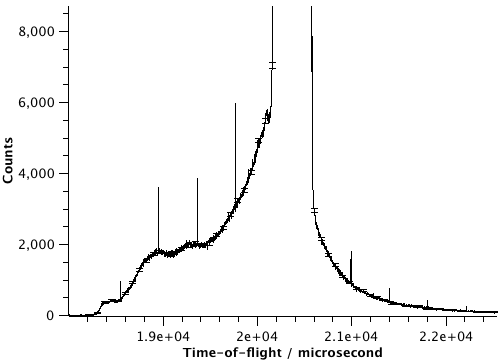
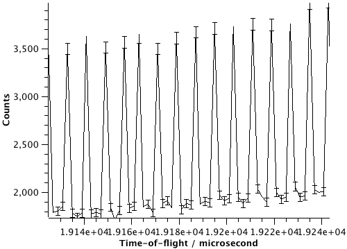

(v2.0.0-isis_event_files_randomization)=

# ISIS event files randomization

```{note}
These release notes were migrated from the retired Mantid wiki (archive.mantidproject.org).
```

Events at ISIS are recorded with finite resolution which is effectively binning of the data. If the time of an event is set to the centre of the bin it may lead to unwanted artefacts in the processed data.



To prevent this instead of putting into the centres


the events are randomized within their bins


