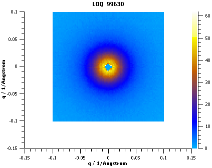

(v2.0.0-isis_sans)=

# ISIS SANS

```{note}
These release notes were migrated from the retired Mantid wiki (archive.mantidproject.org).
```

## Qxy

The Qxy algorithm has been updated to take into account pixel and wavelength dependent corrections according to equations provided by the ISIS SANS scientists; and where standard deviations from such correction files are propagated through to final error estimates. The Qxy algorithm will now also allow cutoffs in wavelength and distance to be specified. Correcting for detector efficiency is an example of a pixel correction and in the picture below shows the output from a LOQ 2D reduction where a flood file was used to correct for detector efficiencies:



## Other

- Bug fixes related to: new M4 monitor, avoid saveRKH saves itself twice and getting phi masking to work better
- Move instrument components for transmission and direct runs
- Allow header for cvs batch file
- When using phi masking a tag is now appended to the output workspace name when appropriate
- Specifying a none cylinder sample geometry now works, i.e. a disc or flat plate sample geometry
