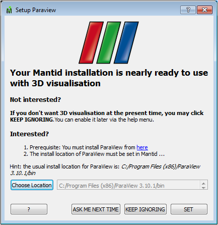

(v2.1.0-installer)=

# Installation

```{note}
These release notes were migrated from the retired Mantid wiki (archive.mantidproject.org).
```

## General Information

A significant amount of effort has been put into this iteration to make the install process easier for our users. There are several advantages provided by these changes:

- Eliminates the need for a separate VATES package. We have one package, MantidPlot, which contains everything
- Detection of the presence of our ParaView dependency Visualisation tools dynamically rather than complicated path setups
- We now only load relevant plugins according to the state of the platform determined dynamically
- Maintenance of the packaging tools will be much easier since they now all use the same packaging technology

The new packaging affects all platforms, some less than others.

## Windows Changes

Changes have been focused on making the VATES integration much easier for users. The install is also quicker.

### Changed Install Instructions

1. Before you start **As a one off, if you have MantidPlot already installed, you will need to remove it first**
1. You will then simply need to run the Mantid-\{Version}-win{64|32}.exe obtained from the download site [here](http://download.mantidproject.org/).
1. Upon startup, you may see a dialog warning you that you might have an old version of MantidPlot installed, if you have removed MantidPlot, just click, yes to continue, otherwise click no to exit the installer and remove MantidPlot manually from your system before starting again.
1. A dialog will show to let you know that any instances of the new installer will be automatically removed, and that this may take some time. Click OK and be patient until the installer starts.
1. Select through the install wizard. Agree to the licence and the download location. When it completes, you should have a MantidPlot shortcut on your desktop and in your start menu.
1. Start up MantidPlot. You'll see a one-time only startup dialog (see below). More information on this can be found at Paraview Setup



As a technical aside, we no longer use WxS, which will significantly reduces the effort associated with future releases.

## Ubuntu Changes

There is no separate VATES package. The system is queried to see if it can support VATES features. VATES is only loaded if this is deemed okay.

## Changed Install Instructions

1. Use the Mantid debian package the same way as previously
1. Install the paraview debian package from here to enable the VATES features [here](http://download.mantidproject.org/).

## RHEL6 Changes

There is no separate VATES package. In order to successfully 'upgrade' an existing install that has both the mantid and mantid_vates rpms, you will need to remove the mantid_vates rpm package. The system is queried to see if it can support VATES features. VATES is only loaded if this is deemed okay.

1. Use the Mantid rpm package the same way as previously, **You will however need ParaView** to complete the deployment of the Mantid package now.

## Mac Changes

Our Mantid distribution on the Mac is currently not built or distributed with the VATES features. We will rectify this early in the next release.
