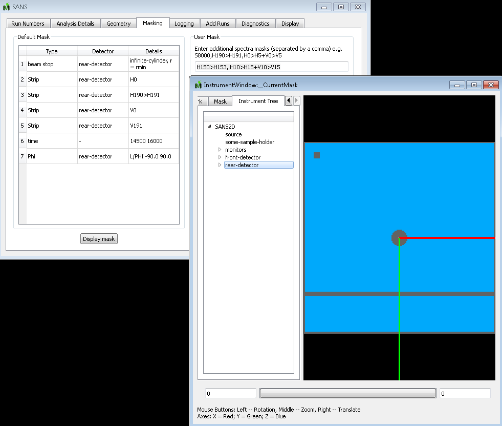

(v2.1.0-isis_sans)=

# ISIS SANS

```{note}
These release notes were migrated from the retired Mantid wiki (archive.mantidproject.org).
```

## Changes include

- Allow event files to be added in the sans gui and subsequently analysis
- Made the MASK wiki documentation and code consistent
- Getting 'MASK Vn>Vm+Hn>Hm' to work and getting Phi masking to work in the gui
- DET/CORR/FRONT/RADIUS and DET/CORR/FRONT/SIDE added, see SANS_User_File_Commands#DET. Note also added ISISCommandInterface method 'SetDetectorOffsets' for setting any of DET/CORR encoders from python
- Distance numbers now correct in Geometry tab
- Added {ref}`NIST Qxy <algm-SaveNISTDAT>` save option
- Display more useful message when using BACK command
- Specifically enforce that LoadRKH is used for loading flood file to suppress warnings
- Add systemtest which test period selection in batch mode
- Made units of Rcut mm consistent across C++ and Python interfaces
- Fix bug when displaying masking instrument view. Horizontal masked lines now display as:


