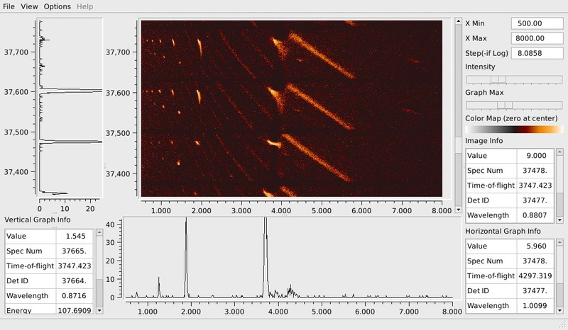

(v2.1.0-single_crystal_diffraction)=

# Single Crystal Diffraction

```{note}
These release notes were migrated from the retired Mantid wiki (archive.mantidproject.org).
```

## Notable Algorithm Additions/Improvements

1. {ref}`TransformHKL <algm-TransformHKL>` allows the user to adjust the Miller indexes assigned to a peak, by specifying a 3x3 matrix.
1. CalibrateRectangularDetectors now has a GetDetOffsetsMultiPeaks option that is much faster and uses more peaks for the calibration.
1. {ref}`SaveHKL <algm-SaveHKL>` uses getScattering for the peak scattering angle instead of needing an instrument attached to the peaks workspace. Also a test should be added for this algorithm.
1. New {ref}`SortHKL <algm-SortHKL>` algorithm
1. CheckWorkspacesMatch works for PeaksWorkspaces

## Preview of New Image Viewer

This release includes a "preview" version of a viewer for a large collection of spectra. This viewer can be started from the right-click menu of an event workspace by selecting "Show Image Viewer". Each row of the image represents one spectrum. For more details see Image Viewer



## Chunking

Chunking is now available for SNSPowderReduction so data files that will not fit in the memory of your computer can be reduced in chunks. Set MaxChunkSize to the number of Gbytes of your system.

## System Testing

Several diffraction workflows are now included in our nightly system test suite. These allow us to benchmark and monitor expected results on a frequent basis.
