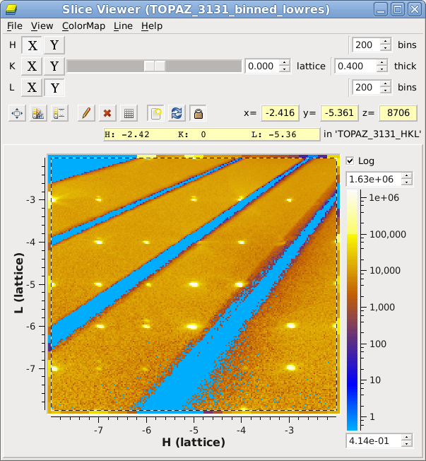
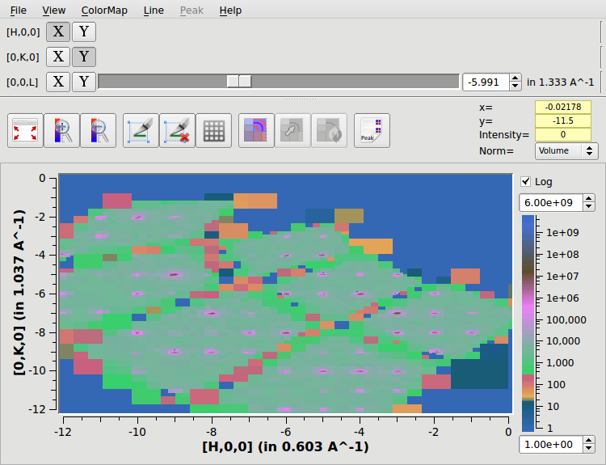
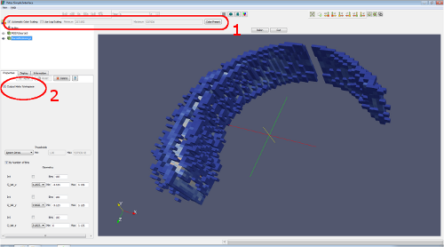
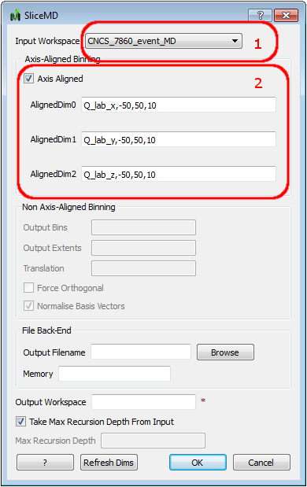
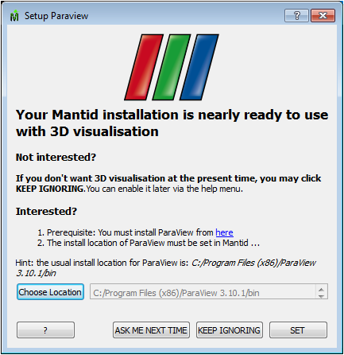
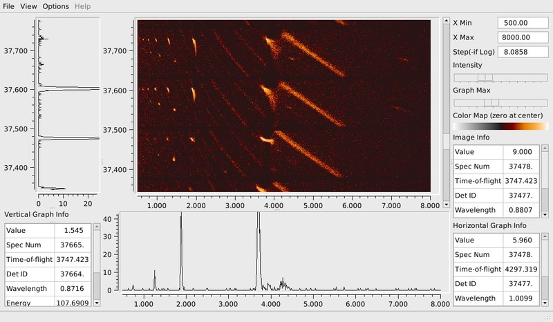

(v2.1.0-vates)=

# Vates

```{note}
These release notes were migrated from the retired Mantid wiki (archive.mantidproject.org).
```

## Notable Algorithm Additions and Improvements

1. New MaskMD {ref}`MaskMD <algm-MaskMD>` algorithm. It is now possible to provide an MDWorkspace with masking information.
1. New {ref}`ConvertToDetectorFaceMD <algm-ConvertToDetectorFaceMD>` algorithm can be used with the SliceViewer to view slices in detector space with TOF as the 3rd dimension. You can rebin and do line plots in detector space in this way (RectangularDetectors only).
1. {ref}`ConvertToDiffractionMDWorkspace <algm-ConvertToDiffractionMDWorkspace>` can now preserve all bins (including zeros) using the OneEventPerBin option. This is useful for summing runs with different goniometer settings.
1. {ref}`BinMD <algm-BinMD>` tracks the number of contributing events, which means that number-of-events-normalization works with binned MDHistoWorkspaces also.

## Slice Viewer

User feedback has indicated that the Slice Viewer SliceViewer had been a popular addition to the tool set. We have endeavoured to make it even better during the present iteration.

### Rebinning a Viewed Slice

Should allow users to dynamically rebin their data, with a given thickness and number of bins, in the region they are viewing in the SliceViewer. For more information see MantidPlot:\_SliceViewer



### Left-click Zooming

Left-click and drag a rectangle to zoom into a region.



### Other Notable Improvements

1. View Matrix Workspaces directly in the SliceViewer
1. You can display signal normalized by volume or by number of events per bin, or choose no normalization.
1. SliceViewer: you now have the option to show bins with zero signal, or to keep them transparent.

## Vates Simple Interface

Most of the work conducted on the Vates Simple Interface during his iteration has revolved around improving stability and preventing misuse. There have been a small number of improvents to the overall layout and design.

### Improvements

1. Colour controls are built into the default GUI view
1. Can dynamically rebin either to a histogrammed/image representation or a full event based repesentation visually
1. Progress reporting includes time taken to construct visualisation dataset



### Stability

1. Better behind-the-scenes checking for enabling the Vates Simple Interface depending upon workspace and environment.
1. Prevention, and friendly warnings about overplotting multiple workspaces in certain views
1. Extensive bounds checking for the Rebinning filters

## Rebinning Improvements

### Smarter Algorithm GUIs

SliceMD and BinMD will query the input workspace and pre-populate the required rebinning fields based on the input. This makes the rebinning algorithms much easier and faster to use. Other checks are provided to help steer the user toward a valid input set.



Example shows the ability to select only workspaces currently in the WorkspaceList (1). In example, inputs (2) are dynamically determined from the selected workspace.

## Infrastructure

### Packaging

With Vates in mind, our packaging process has been overhauled. There is no longer a separate Vates package. see {ref}`Release Notes Installer Changes <v2.1.0-installer>` for more details

### End-to-End Testing

We have greatly improved our test coverage for user provided workflows. With the aid of various groups, we are automating the execution of commonly run workflows (at least once per day) to ensure that Mantid always produces the same reliable set of results.

## Dynamic Vates Loading

There are two parts to this.

1. Telling MantidPlot where ParaView is. This is remembered.
1. MantiPlot querying the system to determine if it can support the 3D visualisation components before making them available.

On Windows, users will get a setup dialog (see below), which can be used to point to the ParaView install. This is a one-time setup step \[[Paraview_setup]|Paraview Setup\]. On Ubuntu, we've repackaged ParaView such that our distributed versions will put all the ParaView libraries in locations whereby they will be immediately detected by MantidPlot. On other linux platforms, you must install ParaView 3.10.1 and then ensure that the LD_LIBRARY_PATH includes the location of the paraview libs.



## Preview of the Image Viewer

This is fully covered elsewhere in these release notes {ref}`Single Crystal Diffraction <v2.1.0-single_crystal_diffraction>`, but deserves a mention here too. 
