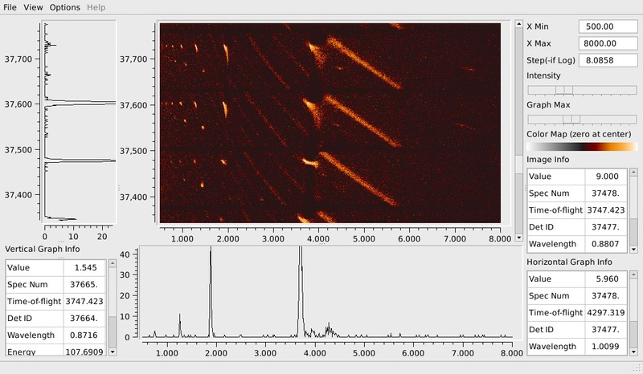

(v2.2.0-diffraction)=

# Diffraction

```{note}
These release notes were migrated from the retired Mantid wiki (archive.mantidproject.org).
```

## Peak Processing Improvements

- You can now add peaks workspaces together using {ref}`CombinePeaksWorkspaces <algm-CombinePeaksWorkspaces>`
- You may also subtract peak workspaces using {ref}`DiffPeaksWorkspaces <algm-DiffPeaksWorkspaces>`
- {ref}`IntegratePeaksMD <algm-IntegratePeaksMD>` can determine when the peak radius or background shell is falling off the detector edge
- {ref}`SortHKL <algm-SortHKL>` will now work with non-integer HKLs
- {ref}`IndexPeaks <algm-IndexPeaks>` improved to better handle peaks workspaces with peaks from several runs

## ImageViewer

The MantidPlot ImageViewer , which was prototyped during the last iteration, is now fully operational and nearly feature-complete. Specific improvements include:

- Support for matrix workspaces (in addition to the event workspaces previously supported)
- "Immediate" rebinning of the X-axis in either Log or uniform bins
- Coordinated scrolling of the horizontal and vertical cuts along with the image
- Range control for the graphs of horizontal and vertical cuts
- "Two-sided" "psuedo-log" color scales to support negative intensities from subtracting workspaces
- More complete readout of equivalent units for pointed at features

See the ImageViewer page for specific improvements to this tool.



## Other Improvements

- {ref}`SumNeighbours <algm-SumNeighbours>` will support detectors other than just rectangular detectors.
- Improve algorithms that set a conventional cell and {ref}`TransformHKL <algm-TransformHKL>`
- Add monitor count to the single crystal peak object.

## Defects Fixed

- Goniometer would not work with psi value loaded from nxspe file.
