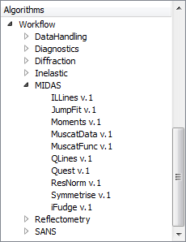

(v2.2.0-indirect_inelastic)=

# Indirect Inelastic

```{note}
These release notes were migrated from the retired Mantid wiki (archive.mantidproject.org).
```

## Convert To Energy

- File finding speed is now greatly increased for users loading large ranges of runs from folders containing a large number of files.

- Detailed balance now correctly using {ref}`ExponentialCorrection <algm-ExponentialCorrection>`, with Operation set to "Multiply".

## Indirect Data Analysis

- MSDFit changes, including the ability to select multiple runs via "Browse".

- Modifications and additions made to the list of MIDAS PythonAlgorithms available to Indirect users (which will eventually have their own tabs in the IDA interface itself). These algorithms are now accessible via Workflow->MIDAS in the Algorithms menu:



- Correct naming of result workspaces for FuryFit/ConvFit.
- Fitting property values update properly in FuryFit/ConvFit.

## Misc

- Greatly improved user validation.
- Much wider system test coverage, to help catch any bugs accidentally introduced through further development.
- Stopped several crashes.
- Various small cosmetic fixes.
