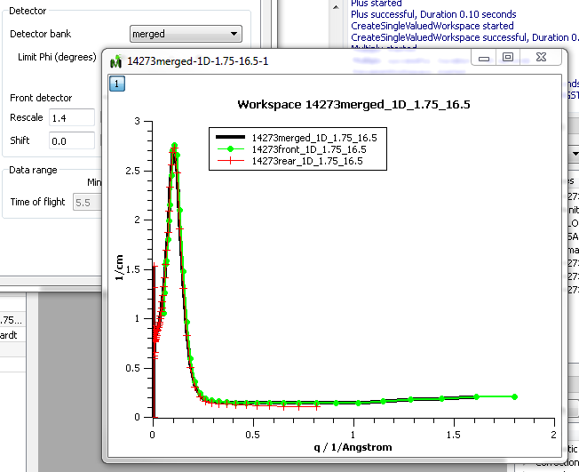

(v2.2.0-isis_sans)=

# ISIS SANS

```{note}
These release notes were migrated from the retired Mantid wiki (archive.mantidproject.org).
```

The main feature added to this release is to allow merging of front and rear detector data according to the equation:

```

```

{math}`C_F` and {math}`C_R` are the sum of front and rear detector counts in a Q bin respectively and {math}`N_F` and {math}`N_R` are the corresponding sum of normalising factors.

The SHIFT and RESCALE parameters may be specified in the SANS GUI or in the user file. The merging can be performed from the GUI as demonstrated in the figure below or from python using WavRangeReduction(), which allow an additional optional argument. \

