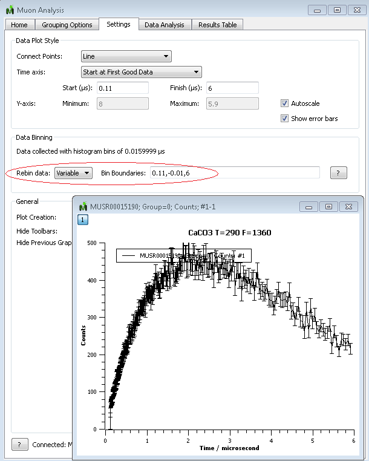

(v2.2.0-muon)=

# Muon Analysis

```{note}
These release notes were migrated from the retired Mantid wiki (archive.mantidproject.org).
```

## Improvements

- Allow variable rebinning of Muon data
- Change phase angle range to (-pi:+pi) in Muon Oscillating Fit Functions
- Change the deadtime loading options to: 'None', 'From Data File', 'From Disk'

## Bug fixes

- Fixed linear fitting in MuonRemoveExpDecay and {ref}`CalMuonDeadTime <algm-CalMuonDeadTime>`
- Fixed bug when loading current run period data
- Remove fit error message "You are overlaying plots from data having differing units"

The screenshot below shows an example where variable rebinning has been selected as "0.11, -0.01, 6" which from 0.11 rebin in Logarithmic bins of 0.01 up to 6.


