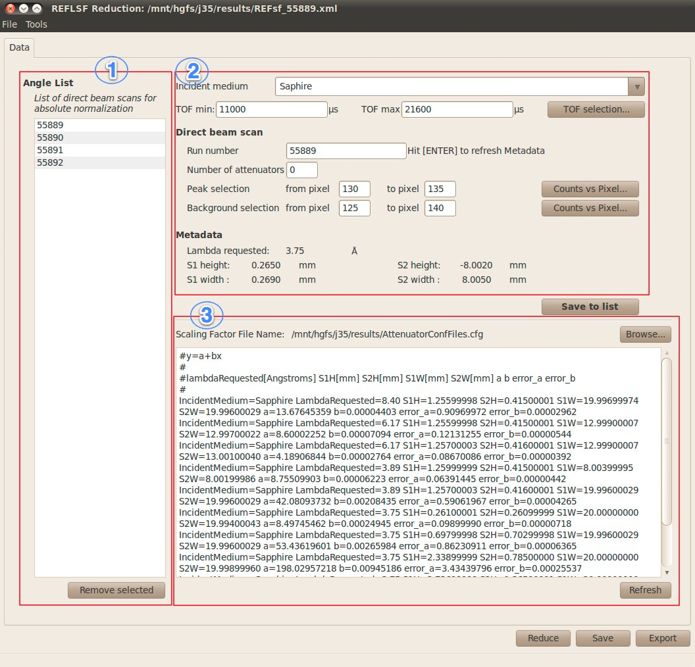
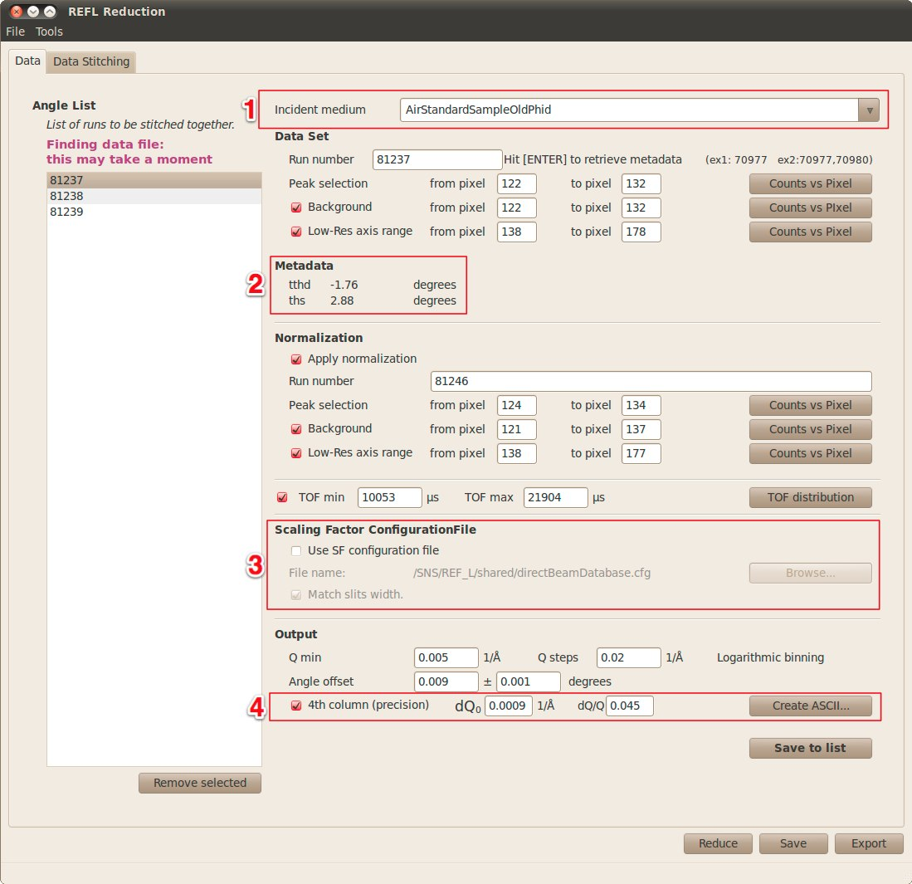

(v2.2.0-reflectometry)=

# Reflectometry

```{note}
These release notes were migrated from the retired Mantid wiki (archive.mantidproject.org).
```

## New Features

### NormaliseByDetector

A new algorithm called {ref}`NormaliseByDetector <algm-NormaliseByDetector>` has been put into Mantid, which enabled normalisation with respect to detector efficiencies as a function of wavelength across an instrument. User has options to supply coefficients and efficiency functions at any component level. Efficiency functions may be delivered either via the {doc}`IDF </concepts/InstrumentDefinitionFile>` for related Instrument Parameter file.

### ConvertToReflectometryQ

As part of the improvements made during this iteration, we can convert a Histogramed workspace into various Q-space projections using the incident and final theta values. See {ref}`ConvertToReflectometryQ <algm-ConvertToReflectometryQ>` for more details.

### Stitch1D

{ref}`Stitch1D <algm-Stitch1D>` created to combine multiple reflectometry runs in Q-space. Includes the ability to scale and combine two workspaces via an overlap region. New algorithms {ref}`WeightedMeanMD <algm-WeightedMeanMD>` and {ref}`CreateMDHistoWorkspace <algm-CreateMDHistoWorkspace>` delivered in-situ.

### FindReflectometryLines

A new {ref}`FindReflectometryLines <algm-FindReflectometryLines>` Calibration algorithm. This algorithm is designed to automatically identify the spectrum numbers corresponding reflected and transmission lines so that sample and detector positions can be corrected.

### SNS Graphical Interfaces

#### Liquids Reflectometer Automatic Scaling Factor Calculation Graphical Interface

This graphical interface has been developed to simplify the calculation of the various scaling factor that will be used during the reduction process of the SNS Liquids Reflectometer instrument.\
Please look at the complete description of this application at this location.\


#### Liquids Reflectometer Data Reduction Graphical Interface

(Only the new features are presented here. For a complete description of this application, please refer to REFLReductionInterface.)\
\
**1** and **3** - It is now possible to select a *scaling factor* configuration file produced by the REF SF Reduction GUI. \
After selecting the configuration file (3), select the *incident medium* of interest (1). The reduction will be performed but before moving to Q space, each data set having a matching *lambda Requested*, *slits heights* and optionally *slits widths* will be scaled by the function defined in the configuration file. It is important to notice that this scaling function is TOF dependent.\
**2** - Display some metadata (tthd and ths).\
**4** - User can create a 3, or 4 columns, ascii file of the reduced data set. 4th column being the *precision* of the Q axis.

## Defects Fixed

- Fixes to multi-period workspace loading. We new provide correct period numbers for files in the ISIS nexus format.
- Fix {ref}`NormaliseByCurrent <algm-NormaliseByCurrent>` to work properly with multi-period data.
- Fix {ref}`MergeRuns <algm-MergeRuns>` to merge across runs with equal period when provided with multi-period group workspace inputs.

## Other Features

- Greatly improved system test coverage over the reflectometry functionality to ensure continuous, accurate, and fast processing of Reflectometry Workflows.
- The ImageViewer has been greatly improved during this iteration. See {ref}`Diffraction Release Notes <v2.2.0-diffraction>` for more information.
