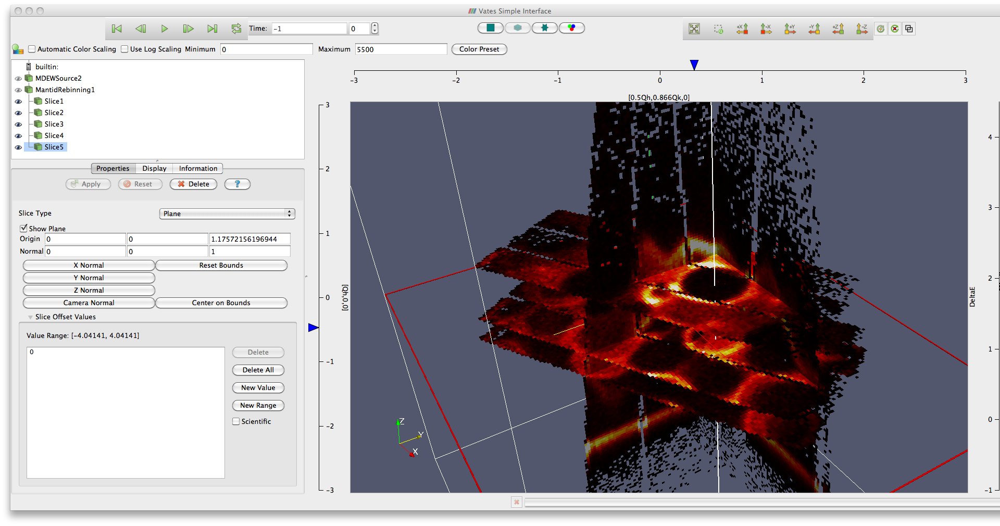

(v2.2.0-vates)=

# Vates

```{note}
These release notes were migrated from the retired Mantid wiki (archive.mantidproject.org).
```

## Cross-Platform Support

As well as supporting Mantid on the same platforms we used to, we now build and ship a version of Mantid that supports VATES on OS X. 

### Quantification

The core part of the quantification engine has been implemented. The framework allows for custom resolution models, foreground models and background models to be plugged in much like the algorithm framework. This release ships with a single resolution model, TobyFitResolutionModel, along with a single foreground model, Strontium122. This is to be taken as a first cut at comparing the fit/simulations with those of [Tobyfit](http://tobyfit.isis.rl.ac.uk/Main_Page). For more information see Vates Quantification

This is an area of active development.

### Importing and Exporting Data

These new algorithms provide a simple way to import small volumes of multi-dimensional data into mantid. These algorithms are ideal for working with and comparing against existing data, without the overhead of generating custom data handling Algorithm for every file format.

- {ref}`CreateMDHistoWorkspace <algm-CreateMDHistoWorkspace>`. Creates a multi-dimensional histogrammed workspace MDHistoWorkspace from input arrays.
- {ref}`ImportMDHistoWorkspace <algm-ImportMDHistoWorkspace>`. Creates a multi-dimensional histogrammed workspace MDHistoWorkspace from an input ASCII file.
- {ref}`ImportMDEventWorkspace <algm-ImportMDEventWorkspace>`. Creates a multi-dimensional workspace MDEventWorkspace from an input ASCII file.

We also now have {ref}`SaveMD <algm-SaveMD>` saving MDHistoWorkspaces as well as MDEventWorkspaces.

### Other Algorithms

- There is now a {ref}`WeightedMeanMD <algm-WeightedMeanMD>` algorithm, that works in a similar fashion to the existing {ref}`WeightedMean <algm-WeightedMean>` algorithm.
- {ref}`QueryMDWorkspace <algm-QueryMDWorkspace>` now has options for the type of normalisation to use.

### Defects Fixed

- {ref}`ConvertToMD <algm-ConvertToMD>` now keeps track of zeros
- Various fixes to the VatesSimpleInterface, particularly around working with 4D data
