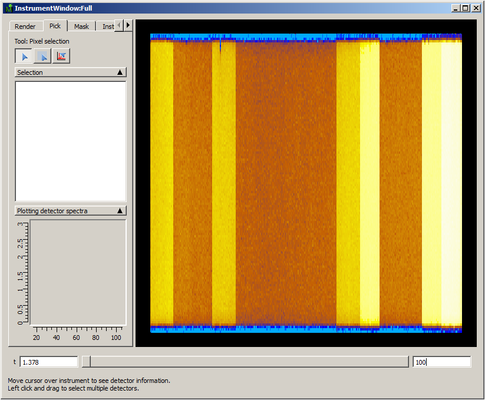

(v2.3.0-diffraction)=

# Diffraction

```{note}
These release notes were migrated from the retired Mantid wiki (archive.mantidproject.org).
```

## New Features

- New WISH IDF for the new 6-panel set-up
- {ref}`RebinByPulseTimes <algm-RebinByPulseTimes>` diagnostic algorithm added



- New scripts for Thermo-Diffractogram plots of GEM data
- More robust version of GetDetOffsetsMultiPeaks ([c++ source](http://github.com/mantidproject/mantid/blob/master/Code/Mantid/Framework/Algorithms/src/GetDetOffsetsMultiPeaks.cpp))
- {ref}`LoadPDFgetNFile <algm-LoadPDFgetNFile>` to load various ascii files from [PDFgetN](http://pdfgetn.sourceforge.net/)

## Defects Fixed

- Better load balancing for MPI Algorithms
- Second preview of LeBailFit fitting
- SXD IDF incorrect on a few banks, and now corrected.
- TOPAZ and NOMAD IDFs updated and improved
- Fix SmoothNeighbours to better determine what sort of processing to perform.
- Update IntegratePeakTimeSlices to better detal with weaker and edge peaks
