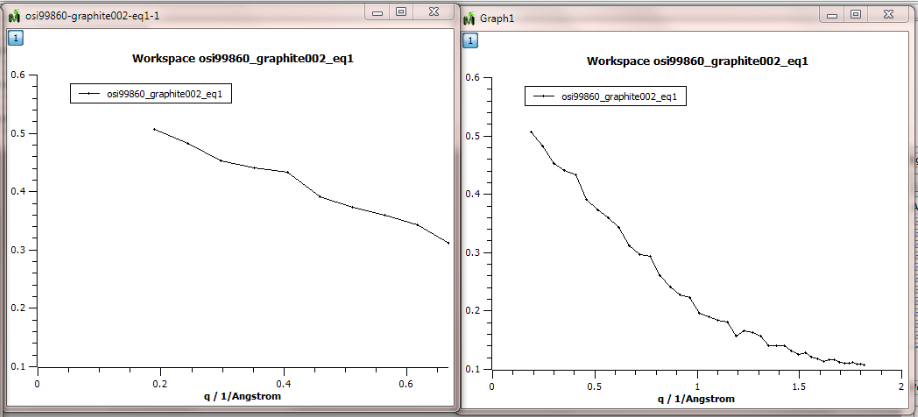

(v2.3.0-indirect_inelastic)=

# Indirect Inelastic

```{note}
These release notes were migrated from the retired Mantid wiki (archive.mantidproject.org).
```

## Bug Fixes

- Not all points were being plotted when users clicked "Run" while "Plot Result" was checked in the IDA interface but the correct graph was produced when users plotted the spectrum after right-clicking the "Workspaces" area. Example below (Left graph produced by clicking "Run" and right graph by clicking "Plot Spectrum...")



- "Calibration" in Convert To Energy Transfer inteface wanted the background to be taken over the whole range instead of users being able to pick specific values.

## Other Changes

- FuryFit now gives correct error bars for all parameters in the fitting.
