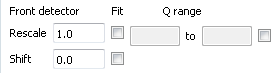

(v2.3.0-isis_sans)=

# ISIS SANS

```{note}
These release notes were migrated from the retired Mantid wiki (archive.mantidproject.org).
```

## Fitting front and rear data

In the previous version reduced front and rear data was allowed to be merged. For this realease this has been extended to allow fitting of front reduced data against rear reduced data. This fitting may optionally be done over a selected Q range. This fitting is available from batch mode, multiple wavelenght ranges mode and in single mode.

Below is shown the part of the Analysis tab that is used to control the fitting (For a picture of merged data see {ref}`ReleaseNotes_2_2_ISIS_SANS <v2.2.0-isis_sans>`): 

## Fixes to the diagnostic tab

Bugs have been fixed for this tab to make it stable and it has been enabled.
