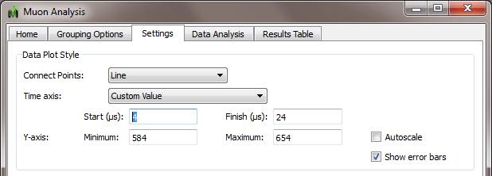

(v2.3.0-muon)=

# Muon Analysis

```{note}
These release notes were migrated from the retired Mantid wiki (archive.mantidproject.org).
```

## New "Custom Value" Option

A new option from the combobox which allows users to enter custom values for the start time. This is available from the "Settings" tab within the Muon Analysis interface.



## Other changes

```{figure} ../../images/2_3_release/Muon_Analysis_Check_Box.webp
---
class: screenshot
width: 200px
align: right
---
Checked boxes now remembered when users navigate between tabs.
```

- After a new fit is completed, if check boxes in the "Include" column of the "Results Table" tab are selected, they remain checked if the user navigates through Muon Analysis interface, even if they perform a fit on another set of data.
- Order of plotting data has changed - the algorithm selected in the "Plot type" field use to be applied to the workspace resulting from any algebra (+ or -) done on the periods that may have been specified by the user. Now this is reverted, the result of this that this correct a problem found when plotting asymmetry pair plots.
