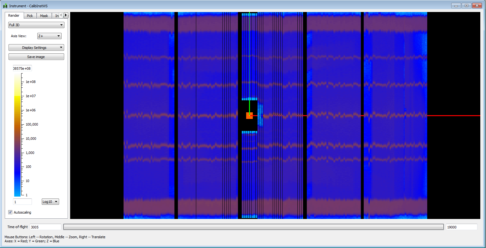
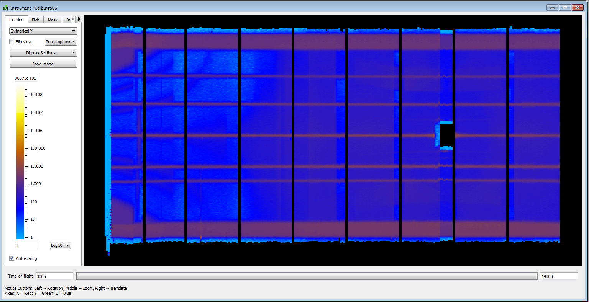

(v2.3.0-tube_calibration)=

# Tube Calibration

```{note}
These release notes were migrated from the retired Mantid wiki (archive.mantidproject.org).
```

Python code supporting calibration of tubes has been added. This code has been used on MERLIN and WISH. It is available in the calibration subdirectory of scripts directory. See Tube Calibration.

Also there are some new algorithms to support calibration,

- {ref}`ApplyCalibration <algm-ApplyCalibration>` which applies a calibration stored in a table workspace to a matrix workspace
- {ref}`CopyInstrumentParameters <algm-CopyInstrumentParameters>` which enables you to transfer a calibration to another workspace
- {ref}`ModifyDetectorDotDatFile <algm-ModifyDetectorDotDatFile>` enables a calibration to be transferred to an ISIS dot dat file.

## An example calibration

The following images show the effect of tube calibration on the MERLIN instrument from excuting the example TubeCalibDemoMerlin_Simple.py in Tube Calibration Examples.



This is what the calibration run looks like without calibration.



This is what the same calibration run looks like with calibration.
