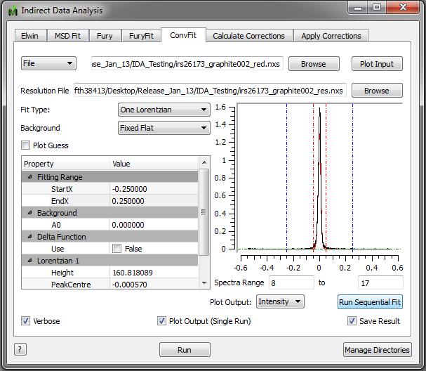
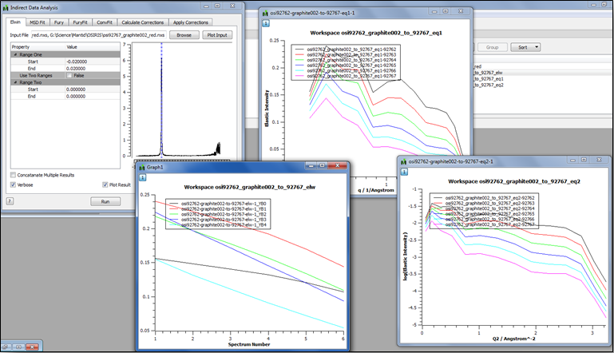

(v2.4.0-indirect_inelastic)=

# Indirect Inelastic

```{note}
These release notes were migrated from the retired Mantid wiki (archive.mantidproject.org).
```

## Convert to Energy

### Energy Transfer

- New option to scale the intensity by multiplying with a specified factor.

## Indirect Data Analysis

- ‘Verbose’ option activated throughout the interface, apart from the ‘Calculate Corrections’ and ‘Apply Corrections’ tabs.



### Elwin

- Instead of creating **eq1** and **eq2** workspaces and **.nxs** files for each run individually, a single workspace and file are now created with a histogram for each run. There is a temporary workspace **elw** to enable plotting of intensity by run-number.



### MSD Fit

- Now uses the new format of **eq1** and **eq2**. If a temperature log file is available then the fitted msd is plotted as a function of temperature, otherwise as run-number.

### Fury

- FFT now works in point mode rather than histogram mode.

## Other New Features

### 64-bit Windows Fortran Modules

- The fortran code supporting the corrections & bayes routines has been compiled & shipped for 64-bit Windows.

## Misc.

- Few modifications to MIDAS PythonAlgorithms.

## Bugs Fixed

- The absolute correction routine now conjoins spectra together without an unecessary check for an overlap in spectrum numbers.
- The Fury routine now does the FFT on point data rather than histogram data before it is normalized by the integrated value.
