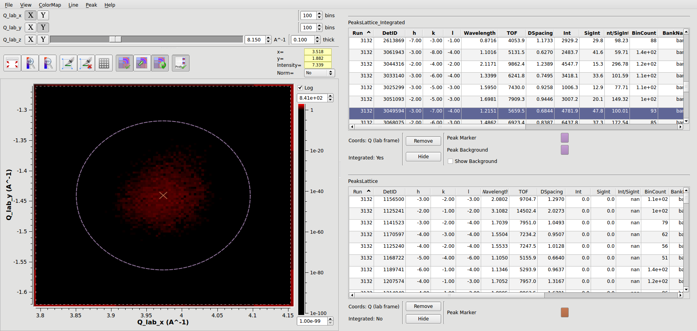
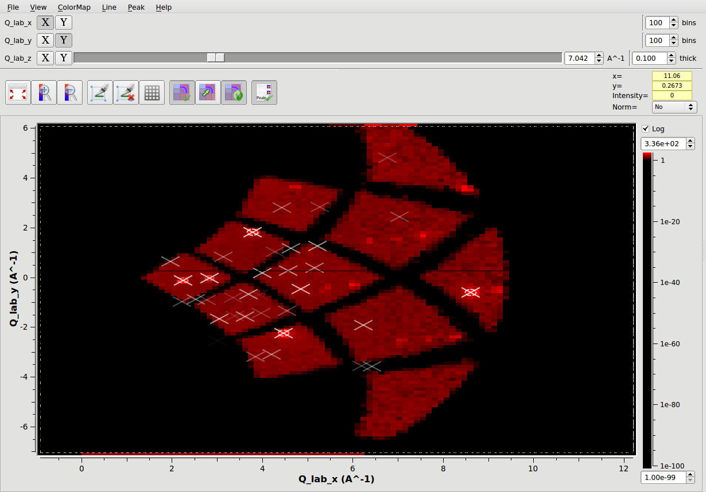
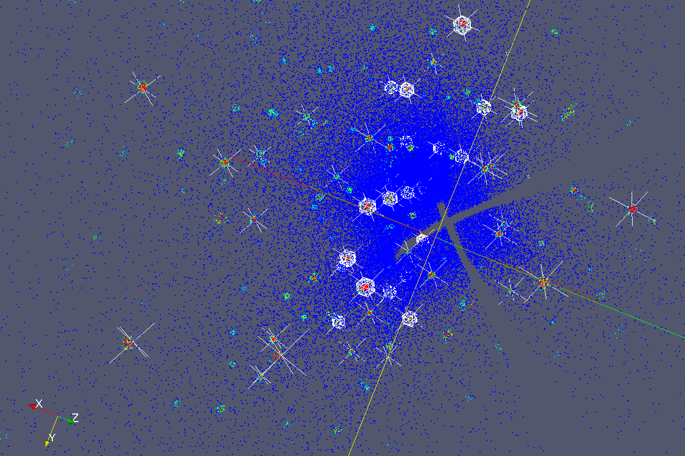

(v2.4.0-vates)=

# Vates

```{note}
These release notes were migrated from the retired Mantid wiki (archive.mantidproject.org).
```

```{figure} ../../images/2_4_release/Vates_release_notes_2_4.webp
---
class: screenshot
width: 400px
align: right
alt: Vates release notes 2 4
---
```

## New Features

### PeaksViewer

This is a new addition to the SliceViewer for working with PeaksWorkspaces.



Features include:

- Slicing through the combined PeaksWorkspace and MDWorkspace
- Working with integrated and non-integrated PeaksWorkspaces
- Displaying multiple PeaksWorkspaces simultaneously on the same plot
- Zoom-to-peak functionality via a single-click on a peaks list
- Ordering of individual peaks list directly in the PeaksViewer, by Intensity, D-Spacing ...
- Customisation of peak foreground and background colours
- Features for easy management of multiple PeaksWorkspaces, such as the ability to temporarily hide a given PeaksWorkspace in the plot



## ParaView 3D Visualisation Enhancements

- Plotting of the Integrated peaks radius as an Overlay in the VatesSimpleInterface.
- Plotting of cross-hairs for any PeaksWorkspace
- Supported loading of the PeaksWorkspace nxs format files



### Migration Progress

We have also made significant progress towards porting all of our existing Mantid-ParaView plugins, as well as the VatesSimpleInterface to the latest version of ParaView.

### Other Important Items

- CreateFractionalPeaks for magnetic scattering.
- A new peak integration algorithm {ref}`IntegrateEllipsoids <algm-IntegrateEllipsoids>`
- SliceViewer now has an Auto-Rebin control.
- Foreground only option added to TobyFit resolution simulation

## Important Fixes

- {ref}`MergeMDFiles <algm-MergeMDFiles>` has been fixed to properly work in a file-backed manner.
- {ref}`LoadSQW <algm-LoadSQW>` can now load 1, 2 and 3 dimensional SQW files.
- Unable to load Multi-dimensional event workspace files in to ParaView via our ParaView plugins
- Fixed serious issue with the Median and Below threshold range option on the Rebinning ParaView filter
- Fixed issue whereby the coordinate system to plot the PeaksWorkspace in in the 3D visualisation was not being determined.
