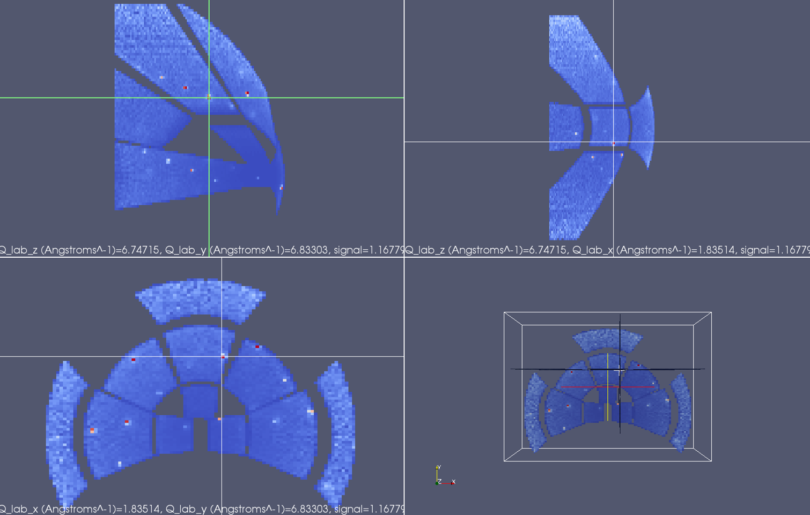

(v2.5.0-diffraction)=

# Diffraction

```{note}
These release notes were migrated from the retired Mantid wiki (archive.mantidproject.org).
```

## Powder Diffraction

## Single Crystal Diffraction

```{figure} ../../images/2_5_release/NaCl_VSI.webp
---
class: screenshot
width: 614px
align: right
---
NaCl single crystal, measured on SXD at ISIS. After peak finding and integration, the peaks have been overlaid over the original data in the QLab frame. Image was created using the new Mantid 3D VATES visualisation tools
```

### New Algorithms

- {ref}`CalculatePeaksHKL <algm-CalculatePeaksHKL>`
- {ref}`PredictFractionalPeaks <algm-PredictFractionalPeaks>`
- {ref}`OptimizeCrystalPlacement <algm-OptimizeCrystalPlacement>`

### New InstrumentView Features for SC

- Utilise a UB Matrix on the viewing workspace to automatically index peaks when they are created in the Pick Tab
- Zoom in/out on the Pick Tab directly

For other changes see Instrument View

### SC Reduction Interface

- A new interface has been added to support Single crystal diffraction. You can read more about it here.

### Instrument Specific Splitting Defaults

The MDWorkspace has proved very useful for SC diffraction due to it's natural ability to provide higher resolution at regions of high intensity. Bragg peaks, for example, can have a much higher box density than those in the surrounding area, which are of little interest. Up till now, the default parameters set on MD conversion algorithms have been optimised to produce structures which are most efficient in memory. These default settings often do not prove good for SC data analysis. We have solved this problem by introducing instrument specific splitting defaults into instrument parameter files. These can be set once, and will be applied as the defaults for every use of conversion algorithms such as {ref}`ConvertToMD <algm-ConvertToMD>` and {ref}`ConvertToDiffractionMDWorkspace <algm-ConvertToDiffractionMDWorkspace>`. For the ISIS WISH instrument, we have shipped such a modified parameter file as part of the release, which contains a good set of default splitting parameters for peak finding.

Splitting Instrument Parameters are:

- **SplitInto**
- **SplitThreshold**
- **MaxRecursionDepth**

Also see http: {doc}`IDF </concepts/InstrumentDefinitionFile>`

### Peaks Viewer

The PeaksViewer on the SliceViewer can now identify if you are viewing an integrated peaks workspace in a different coordinate system from the one it was created in. Warning will be generated to this effect.

### Bench Marking and System Tests

We have been stress testing our new SC diffraction workflows on real data. Standard results have been incorporated into our nightly system test runs to ensure that these standard results are never affected by the ongoing development work on Mantid.



NaCl single crystal, measured on SXD at ISIS. Synchronised plane slices through the data. Image was created using the new Mantid 3D VATES visualisation tools.
