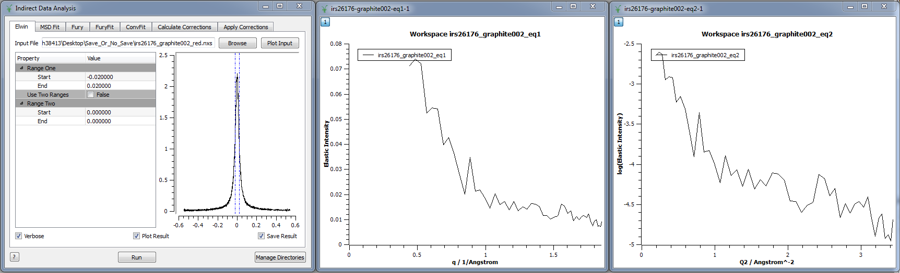
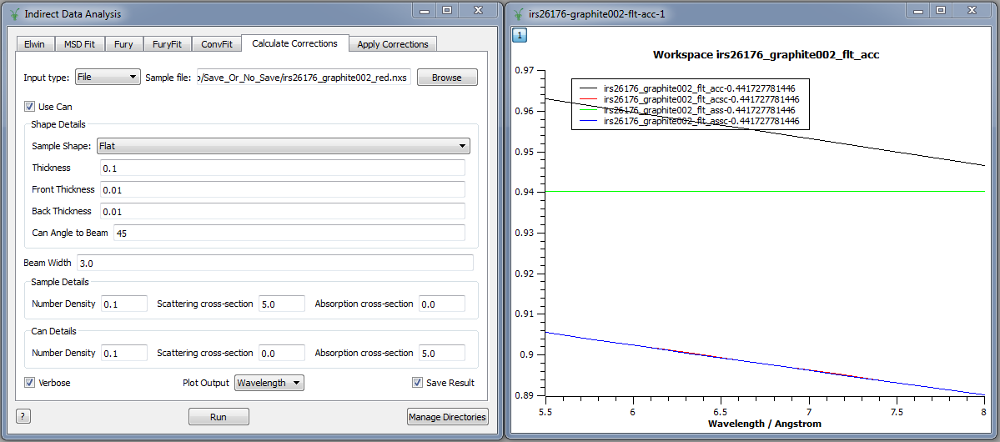

(v2.5.0-indirect_inelastic)=

# Indirect Inelastic

```{note}
These release notes were migrated from the retired Mantid wiki (archive.mantidproject.org).
```

## Convert to Energy

### Energy Transfer

- New option to load log files so that a sample environment parameter, temperature for example, can be used in subsequent programs such as ElWin.

## Indirect Data Analysis

- ‘Verbose’ option now active throughout the interface, giving users the option to follow their processes in more detail.

### Elwin

Now reads a temperature parameter - currently default ‘sample’. It first checks the Log parameters in the Workspace. If not there, it looks for a log file to read and if that does not exist, it uses the run-number instead.

**Three** workspaces are created:

- **eq1** is Intensity v Q
- **eq2** is log(Intensity) v Q2 - primarily for use as input to msdFit.



Both WS have the histograms labelled by Temperature (or run-number) and can be plotted as a contour or in 3D.

- **elf** is a transpose of eq1 so that the histograms are in Temperature and labelled by Q.

### MSD Fit

- Now reads in the eq2 WS so that the data is already in log(intensity) v Q2 as a function of temperature.

### Calculate Corrections

- New 'Save Result' option.

### Apply Corrections

- Interface's plot options now complete.
- New option to scale the container intensity.
- New 'Save Result' option.



## Indirect Diffraction

The interface now works for TOSCA and VESUVIO.

## Other New Features

- **VESUVIO:** Genie routines ported to Mantid.
- **ForCE** for ILL data. Now supports IN13 as well as IN10 and IN16.
