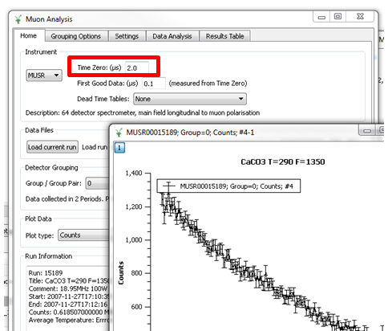

(v2.5.0-muon)=

# Muon Analysis

```{note}
These release notes were migrated from the retired Mantid wiki (archive.mantidproject.org).
```

## New Point of Reference wiki

The new point of reference wiki is Muon, i.e. Muon with capital M. The purpose of this wiki is to store links for novice user and expert users to use the Mantid muon analysis, and any other links that instrument scientists may find useful to include. To get edit rights to this page email mantid-help@mantidproject.org.

## Time zero editable

For muon RF experiments time zero is different from the number specified in nexus files. Here allowed this value to be custom edited which will shift the location of the origin for the data accordingly.


