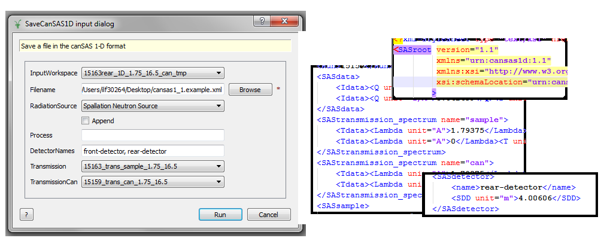

(v2.5.0-sans)=

# SANS

```{note}
These release notes were migrated from the retired Mantid wiki (archive.mantidproject.org).
```

We have created a wiki page to show users when they first have to use Mantid to process SANS data SANS_Data_Analysis_at_ISIS, we hope this will help you presenting them the Mantid Tool.

## New Features

### High Angle Bank

For this release, we have given some attention to the High Angle detector, to process with some functionalities that were able only to the Small Angle detector.

```{figure} ../../images/2_5_release/SANSFloodCorrectionFront.webp
---
class: screenshot
width: 400px
align: right
alt: SANSFloodCorrectionFront
---
```

- Flood correction file for Front detector available also through MON/FLAT.
- Introduction of {ref}`SANS Wide Angle Correction <algm-SANSWideAngleCorrection>` available through SAMPLE/PATH/ON
- {ref}`Q1D <algm-Q1D>` extended to accept Wave and Pixel dependent parameter. The new equation is (if WavePixelAdj) is given (see {ref}`SANSWideAngleCorrection <algm-SANSWideAngleCorrection>`)

{math}`P_I(Q) = \frac{\sum_{\{i, j, n\} \supset \{I\}} S(i,j,n)}{\sum_{\{i, j, n\} \supset \{I\}}M(n)\eta(n)T(n)\Omega_{i j}F_{i j}Corr(i,j,n)}`

### CanSAS - v1.1

- CanSAS now add \<SASdetector> field.
- New version of CanSAS format ([v1.1](http://www.cansas.org/formats/canSAS1d/1.1/doc/index.html)) that is able to Save/Load transmission data (picture)



## Important Fixes

```{figure} ../../images/2_5_release/SANSBeamCentreFinderFront.webp
---
class: screenshot
width: 400px
align: right
alt: SANSBeamCentreFinderFront
---
```

- Correct Find Beam Centre to work properly for both detectors
- Process the CORR/DET option to apply the detector offset.
- Correction of error propagation at {ref}`Q1D <algm-Q1D>` algorithm from:

```

```

to

```

```

- Process the option DET/RESCALE/FIT to enable fit for HAB detector.
- Save the spectrum number for RKH format
- Applies the suffix “\_front”, ”\_rear” or ”\_merged” onto output workspaces in BatchMode
- Show Rectangular banks for SANS2D Event data

```{figure} ../../images/2_5_release/DiagnosticsSANSEventMode.webp
---
class: screenshot
width: 400px
align: right
alt: DiagnosticsSANSEventMode
---
```
