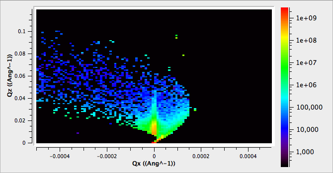
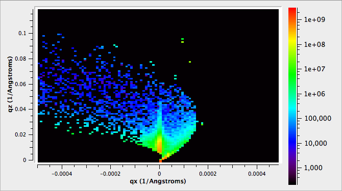
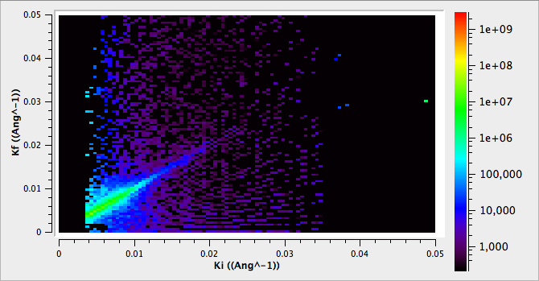
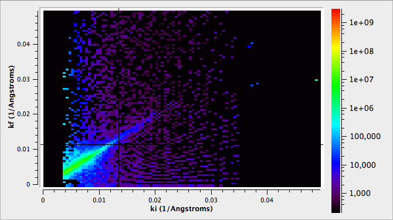
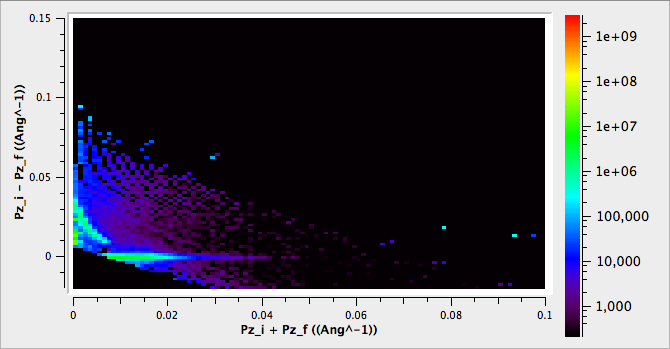
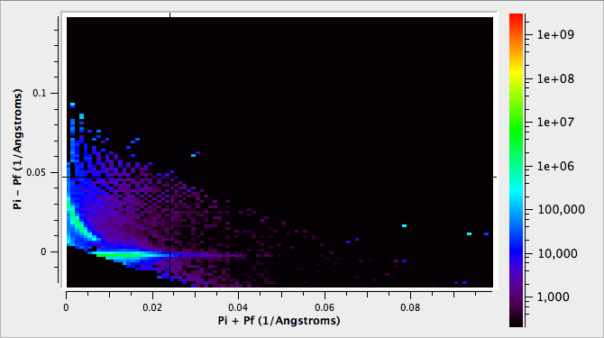

(v2.6.0-reflectometry)=

# Reflectometry

```{note}
These release notes were migrated from the retired Mantid wiki (archive.mantidproject.org).
```

## ISIS Reflectometry

|                              |                              |
| ------------------------------------------------------------------------------------------------------------------- | ------------------------------------------------------------------------------------------------- |
|                              |                              |
|  |  |

### ConvertToReflectometryQ

- Fixed bug associated with top-level image statistics when converting to an adaptively binned workspace
- Fixes to ConvertToReflectometryQ, so as to provide very fine default box-splitting
- Exposed controls for user-intervention of splitting details using ConvertToReflectometryQ
- Adapted ConvertToReflectometryQ, to also output 2D Matrix Workspaces for any of the existing transforms. User can choose output to be either Multi-Dimensional or a Workspace 2D.

### Quick Scripts

- Significant work in providing automated python system testing and unit testing around the existing ISIS Reflectometry scripts, toLam, l2q, quick and combineMulti.
- Moved all the fore mentioned scripts to the new mantid-python version
- Exposed the instrument reference frame to python
- Updates to INTER, SURF, POLREF definitions to include a common set of instrument parameters
- Update to the Reflectometry GUI to the version provided by the Reflectometry Group.
