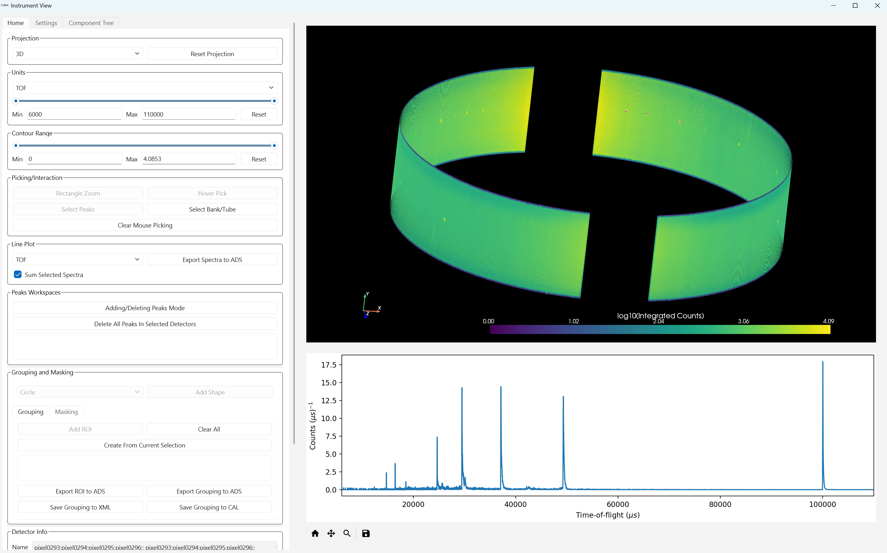

.. _v7.0.0:

===========================
Mantid 7.0.0 Release Notes
===========================

We are proud to announce version 7.0.0 of Mantid.

Key features of this major release include:

- The new :ref:`Instrument View<InstrumentViewer>` is now the default.
- Upgraded from Qt 5 to Qt 6.
- A new :ref:`Texture Experiment Planner <Texture_Planner-ref>` user interface.
- New capabilities for reducing ISIS polarised reflectometry datasets.
- Simplified workspace data access through the ``x()`` and ``mutableX()`` methods of Histogram objects. The older vector-based methods (``readX``, ``dataX``, etc.) have been fully deprecated and replaced throughout Mantid.
- Extended indirect data reduction workflows for the OSIRIS silicon analyser upgrade.
- The :ref:`ConvertToMD <algm-ConvertToMD>` algorithm can now process continuous rotation single-crystal data without intermediate angular binning, reducing memory and disk space requirements.
- Upgraded to Python 3.13. See the `Python 3.13 release notes <https://docs.python.org/3/whatsnew/3.13.html>`__ for more details.
- The :ref:`Script Repository <WorkbenchScriptRepository>` is now read-only when accessed through Mantid Workbench.

These are just some of the many improvements in this release, so please take a
look at the release notes, which are filled with details of the
important changes and improvements in many areas. The development team
has put a great effort into making all of these improvements within
Mantid, and we would like to thank all of our beta testers for their
time and effort helping us to make this another reliable version of Mantid.

Throughout the Mantid project we put a lot of effort into ensuring
Mantid is a robust and reliable product. Thank you to everyone that has
reported any issues to us. Please keep on reporting any problems you
have, or crashes that occur on our `forum`_.

Installation packages can be found on our `download page`_
which now links to the assets on our `GitHub release page`_, where you can also
access the source code for the release.

Citation
--------

Please cite any usage of Mantid as follows:

- *Mantid 7.0.0: Manipulation and Analysis Toolkit for Instrument Data.; Mantid Project*. `doi: 10.5286/SOFTWARE/MANTID7.0 <https://doi.org/10.5286/SOFTWARE/MANTID7.0>`_

- Arnold, O. et al. *Mantid-Data Analysis and Visualization Package for Neutron Scattering and mu-SR Experiments.* Nuclear Instruments
  and Methods in Physics Research Section A: Accelerators, Spectrometers, Detectors and Associated Equipment 764 (2014): 156-166
  `doi: 10.1016/j.nima.2014.07.029 <https://doi.org/10.1016/j.nima.2014.07.029>`_
  (`download bibtex <https://raw.githubusercontent.com/mantidproject/mantid/master/docs/source/mantid.bib>`_)

Changes
-------

.. toctree::
   :hidden:
   :glob:

   *

- :doc:`Framework <framework>`
- :doc:`Mantid Workbench <mantidworkbench>`
- :doc:`Diffraction <diffraction>`
- :doc:`Muon Analysis <muon>`
- Low Q

  - :doc:`Reflectometry <reflectometry>`

  - :doc:`SANS <sans>`
- Spectroscopy

  - :doc:`Direct Geometry <direct_geometry>`

  - :doc:`Indirect Geometry <indirect_geometry>`

  - :doc:`Inelastic <inelastic>`

Full Change Listings
--------------------

For a full list of all issues addressed during this release please see the `GitHub milestone`_.

.. _download page: https://download.mantidproject.org

.. _forum: https://forum.mantidproject.org

.. _GitHub milestone: https://github.com/mantidproject/mantid/pulls?utf8=%E2%9C%93&q=is%3Apr+milestone%3A%22Release+7.0%22+is%3Amerged

.. _GitHub release page: https://github.com/mantidproject/mantid/releases/tag/v7.0.0
